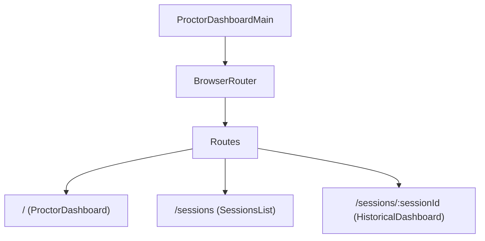

# ProctorDashboardMain Entry Point

## Overview
`ProctorDashboardMain.jsx` is the root React application entry point. It handles React DOM mounting, router configurations using `react-router-dom`, component routing, and pulls the core global CSS styles.

## Key Features
- **Root Mounting** – Mounts the application to the `#root` element in the HTML DOM structure.
- **Client‑Side Routing** – Defines paths to transition between different dashboard interfaces:
  - `/` maps to `ProctorDashboard` (the Live Proctoring center).
  - `/sessions` maps to `SessionsList` (the historical logs dashboard).
  - `/sessions/:sessionId` maps to `HistoricalDashboard` (detailed historical records of a single candidate's exam session).
- **Global Stylesheets Integration** – Combines global styles (`index.css`) with specific proctor styling (`proctorDashboardIndex.css`).

## Routing Architecture

## Security Considerations
- Uses standard client-side routing. No server-side templates or dynamically executed script tags are present in this layer.
- Enforces strict mode with React wrapper (`<React.StrictMode>`) to catch deprecated or unsafe API usages during development.

---
*Generated by Antigravity on 2026‑05‑27*
