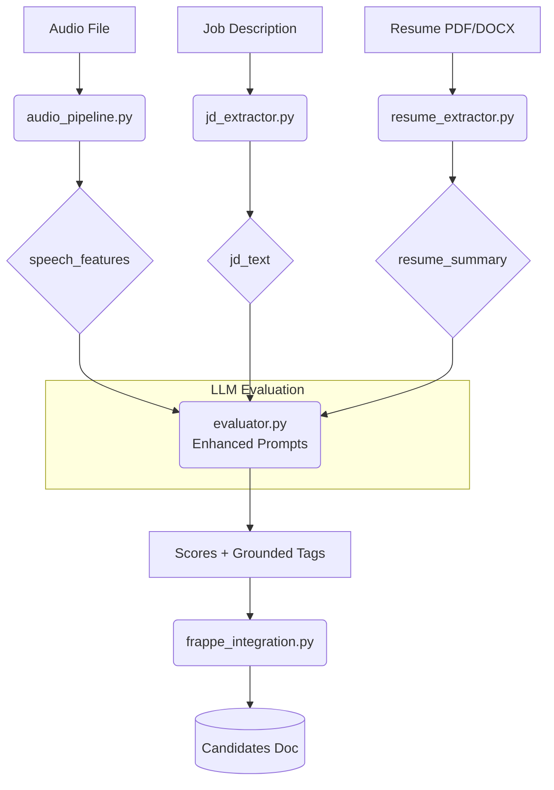

# JD & Resume-Aware AI Screening — Requirements & Implementation Plan

> **Module:** `ai_apps/ai_screening`
> **Date:** 2026-06-20
> **Status:** Draft — Awaiting Approval

---

## 1. Overview

The current AI screening pipeline evaluates candidates **solely from their self-introduction audio** — transcribed and scored against five generic rubrics (Communication, Confidence, Structure, Relevance, Professionalism). This approach is **context-blind**: the LLM has no knowledge of the Job Description (JD) the candidate applied for, or the Resume they submitted.

This document captures the requirements and implementation plan to make the pipeline **JD & Resume aware**, producing Trait Tags that are grounded in all available signals rather than only the spoken audio.

---

## 2. Problem Statement

| Current Limitation | Impact |
|---|---|
| AI scores `Relevance` without knowing the actual JD | Tags like `Strong Role Fit` / `Weak Role Fit` are unreliable |
| AI scores `Professional Awareness` without the resume | `Deep Domain Knowledge`, `Proven Results` have no factual basis |
| Behavioral Tags (e.g. `Takes Ownership`) derived only from how they speak | Miss signals visible only in work history or education pattern |
| Main Tag vs Sub Tag hierarchy not enforced at inference time | LLM may assign Sub Tags that contradict the Main Tag context |

---

## 3. Requirements

### REQ-01 — JD Analysis
The AI must receive and parse the Job Description before evaluating a candidate.

- **Input source:** `Candidates.position` → linked `Job Opening` doctype → `job_description` field (or a plain-text field on the `WEB Page screening` doc).
- **Extracted signals:** Role title, required skills, experience level, domain, key responsibilities.
- **Usage:** Injected into the LLM system prompt as a structured "Role Context" block.

### REQ-02 — Resume Analysis
The AI must receive and parse the candidate's resume/CV before evaluating.

- **Input source:** `Candidates.resume` (file attachment) or a structured text field on the candidate doc.
- **Extraction:** Parse text from PDF/DOCX using a utility function. Pass extracted text to LLM.
- **Extracted signals:** Education, work history, skills listed, years of experience, domain exposure.
- **Usage:** Injected into the LLM user prompt alongside the transcript.

### REQ-03 — JD + Resume Informed Trait Tag Generation
Trait Tags must be generated considering **all three inputs simultaneously**:

1. Audio transcript (speech delivery & content)
2. Resume (background, skills, work history)
3. JD (role expectations, domain, seniority)

The LLM's tag selection must be grounded in the cross-signal evidence, not just what the candidate says.

### REQ-04 — Main Tag & Sub Tag Judgment from All Metrics
The tag taxonomy has a two-level hierarchy:

| Level | Examples |
|---|---|
| **Main Tag** (category) | `communication_traits`, `behavioral_indicators`, `experience_assessment`, `professional_readiness`, `ai_flags` |
| **Sub Tag** (leaf value) | `Strong Role Fit`, `Takes Ownership`, `Deep Domain Knowledge`, etc. |

**Requirement:** The LLM must be instructed to resolve Sub Tags **only after** evaluating all three inputs. A Sub Tag like `Strong Role Fit` is only valid when audio content, resume background, AND JD requirements all agree.

### REQ-05 — Improved Behavioral & Professional Tag Accuracy
- **Behavioral Tags** (e.g. `Takes Ownership`, `Team Minded`, `Low Initiative`) must be cross-validated against resume evidence (past leadership roles, team projects) — not derived purely from speech delivery.
- **Professional Tags** (e.g. `Deep Domain Knowledge`, `Proven Results`, `Ready to Contribute`) must be anchored to resume facts, not inferred from confidence of delivery.

---

## 4. Target Architecture & Data Flow



> [!TIP]
> JD and Resume extraction run independently of the audio processing, allowing for easy fallback handling if one of the inputs is missing.

---

## 5. Implementation Plan

### Phase 1 — Data Extraction Utilities

#### [NEW] `jd_extractor.py`
- `fetch_jd_for_candidate(docname: str) -> str | None`
  - Fetches the `WEB Page screening` doc → reads `position` field → looks up `Job Opening` doctype → returns `job_description` as plain text.
  - Fallback: return `None` if JD is unavailable (pipeline must still work without JD).
- `parse_jd(jd_text: str) -> dict`
  - Extracts: `role_title`, `required_skills`, `experience_level`, `domain`, `responsibilities`.
  - Uses lightweight regex/heuristics; LLM-based parse only if structured data is unavailable.

#### [NEW] `resume_extractor.py`
- `fetch_resume_for_candidate(atsid: str) -> str | None`
  - Fetches the `Candidates` doc → resolves `resume` file attachment → reads file from disk.
- `extract_resume_text(file_path: str) -> str | None`
  - Supports: `.pdf` (exclusively via GLM OCR), `.docx` (via `python-docx`), `.txt`.
  - Returns plain text, truncated to ~2000 tokens if too long.
- `summarise_resume(raw_text: str) -> str`
  - Returns a structured summary block:
    ```
    Education: ...
    Work History: ...
    Skills: ...
    Domain: ...
    Years of Experience: ...
    ```
  - Optionally uses the LLM for this step (lightweight call, small context).

---

### Phase 2 — Enhanced Evaluator Prompt

#### [MODIFY] `evaluator.py`

**2a. New function signature:**
```python
def evaluate_candidate(
    transcript: str,
    quality: dict,
    speech_features: dict = None,
    jd_text: str = None,          # NEW
    resume_summary: str = None,   # NEW
) -> dict | None:
```

**2b. Enhanced System Prompt — Role Context Block:**

When JD is available, inject a dynamic block into the system prompt:

```text
─────────────────────────────────────────
ROLE CONTEXT (from Job Description)
─────────────────────────────────────────
Role Title: {role_title}
Domain: {domain}
Required Skills: {skills}
Experience Level: {experience_level}
Key Responsibilities: {responsibilities}

Use this to anchor your evaluation of Relevance and experience tags.
A candidate whose background matches the JD should receive higher Relevance
and appropriate experience_assessment tags (e.g. "Strong Role Fit").
A mismatch is only penalised if BOTH the resume AND the transcript confirm it.
```

**2c. Enhanced User Prompt — Resume Block:**

When resume is available, prepend it to the user message:

```text
Candidate Resume Summary:
Education: ...
Work History: ...
Skills: ...

─────────────────
Speech Features:
- Energy: ...
- Speaking Rate: ...
- Pause Ratio: ...

─────────────────
Candidate Transcript:
[full transcript text]
```

**2d. Multi-Signal Tag Selection Rules (added to system prompt):**

```text
─────────────────────────────────────────
MULTI-SIGNAL TAG SELECTION RULES
─────────────────────────────────────────
behavioral_indicators:
  - "Takes Ownership" requires evidence from resume (past ownership) OR specific
    examples in transcript. Do NOT assign based on delivery confidence alone.
  - "Low Initiative" requires consistent absence of initiative signals across
    ALL available inputs.
  - "Team Minded" is valid if resume shows team projects OR transcript describes
    collaborative work with specifics.

experience_assessment:
  - "Strong Role Fit" requires resume background AND transcript content to
    align with JD. If JD is unavailable, infer from stated role context.
  - "Deep Domain Knowledge" requires specific domain evidence from resume OR
    detailed technical answers in transcript. Do NOT infer from tone alone.
  - "Weak Role Fit" is only valid if BOTH resume background AND transcript
    content indicate poor alignment with the JD.
  - "Proven Results" requires at least one specific achievement in resume
    OR a concrete measurable outcome described in the transcript.

professional_readiness:
  - "Ready to Contribute" requires resume showing relevant hands-on experience
    AND transcript showing awareness of professional context.
  - "Needs Coaching" is appropriate if BOTH resume and transcript suggest
    early career stage or significant skill gaps vs JD.
  - "Needs Role Exposure" should only be assigned if resume lacks relevant
    industry or functional exposure for the specific JD role.
```

---

### Phase 3 — Pipeline Integration

#### [MODIFY] `frappe_integration.py` — `run_ai_screening()`

Extend Step 2 (audio resolution) to also fetch JD and Resume:

```python
# Step 2.5: Fetch JD and Resume context
from jd_extractor import fetch_jd_for_candidate
from resume_extractor import fetch_resume_for_candidate, extract_resume_text, summarise_resume

jd_text = fetch_jd_for_candidate(docname)           # may be None
resume_path = fetch_resume_for_candidate(atsid)
resume_text = extract_resume_text(resume_path) if resume_path else None
resume_summary = summarise_resume(resume_text) if resume_text else None
```

Pass `jd_text` and `resume_summary` through to `process_single_candidate()`:

```python
raw_result = process_single_candidate(
    audio_path,
    jd_text=jd_text,
    resume_summary=resume_summary,
)
```

#### [MODIFY] `main.py` — `process_single_candidate()`

Update signature and plumb through to `evaluate_candidate()`:

```python
def process_single_candidate(
    audio_path: str,
    jd_text: str = None,        # NEW
    resume_summary: str = None, # NEW
) -> dict:
    ...
    evaluation = evaluate_candidate(
        cleaned,
        quality=quality,
        speech_features=result["speech_features"],
        jd_text=jd_text,           # NEW
        resume_summary=resume_summary,  # NEW
    )
```

---

### Phase 4 — Tag Hierarchy Enforcement

#### [MODIFY] `evaluator.py` — post-processing

Add a `_enforce_tag_hierarchy(result: dict) -> dict` function:

> [!WARNING]
> This post-processing is crucial. Even with strict instructions, LLMs can occasionally generate contradictory outputs. This function provides a deterministic safety net.

**Contradiction Rules:**

| Rule | Action |
|---|---|
| Both `Strong Role Fit` AND `Weak Role Fit` present | Keep the one supported by higher score; remove the other |
| `Deep Domain Knowledge` + `relevance` score < 5 | Remove `Deep Domain Knowledge` |
| `Takes Ownership` with no evidence in resume/transcript | Remove if confidence is `low` |
| `Led Teams or Projects` when relevance score < 4 | Downgrade to `Some Relevant Background` |
| Both `Ready to Contribute` AND `Needs Coaching` | Keep `Needs Coaching` (conservative) |

This function is called after the LLM tag validation block in `evaluate_candidate()`.

---

## 6. Fallback & Error Handling Strategy

> [!CAUTION]
> It is highly likely that some candidates will have missing JDs or unparseable Resumes (e.g. image-based PDFs without OCR). The pipeline **must not fail** in these scenarios.

**Scenario A: JD is missing**
- `jd_text` will be passed as `None`.
- The "Role Context" block is excluded from the system prompt.
- The LLM evaluates based on general professional standards and inferred context from the candidate's speech.

**Scenario B: Resume is missing or unparseable**
- `resume_summary` will be passed as `None`.
- The "Candidate Resume Summary" block is excluded from the user prompt.
- The LLM relies solely on the transcript and speech features, similar to the current baseline pipeline.

**Scenario C: Resume parsing times out or fails**
- `extract_resume_text` must be wrapped in a strict `try-except` block with a timeout (e.g. 5 seconds).
- On failure, log a warning and proceed as if the resume is missing.

---

## 7. Frappe Doctype Considerations

> [!IMPORTANT]
> **Before implementing, confirm the following field availability:**

| Field | Doctype | Expected Type | Notes |
|---|---|---|---|
| `position` | `WEB Page screening` | Link to `Job Opening` | Used to fetch JD |
| `job_description` | `Job Opening` | Long Text / HTML | Source of JD content |
| `resume` | `Candidates` | Attach | PDF/DOCX resume file |
| `resume_text` | `Candidates` | Long Text (optional) | Pre-extracted plain text cache |

If `resume` field does not exist, confirm the actual field name before implementation.

---

## 8. Open Questions

> [!NOTE]
> Please review and provide input on these questions before implementation begins.

1. **Resume field name:** What is the exact field name for the resume attachment on the `Candidates` doctype? Is it `resume`, `cv`, or something else?
2. **JD availability:** Is a `Job Opening` linked consistently from `WEB Page screening.position`? Or is the JD stored as plain text somewhere else?
3. **Resume parsing with GLM OCR:** Since we are using GLM OCR exclusively for PDF extraction, do we need a dedicated API integration, and what are the endpoint details?
4. **Resume summarisation:** Should the resume summarisation step use the LLM (adds ~2–3s latency per candidate) or a deterministic heuristic parser (faster but less accurate)?
5. **Fallback behaviour:** When JD or Resume is unavailable, should the pipeline: (a) proceed with audio-only evaluation (recommended), or (b) route to `Needs Human Review`?

---

## 9. Verification Plan

### Automated Checks
- [ ] Unit test: `fetch_jd_for_candidate()` returns text / `None` correctly for known docs.
- [ ] Unit test: `extract_resume_text()` handles PDF, DOCX, and missing file gracefully.
- [ ] Unit test: `_enforce_tag_hierarchy()` removes contradicting tags as expected.
- [ ] Integration test: `process_single_candidate()` with mock JD + resume → assert `experience_assessment` tags differ from audio-only baseline.

### Manual Verification
- [ ] Run 5 real candidates through the enhanced pipeline.
- [ ] Compare tags before and after — confirm `Strong Role Fit` / `Weak Role Fit` are now JD-grounded.
- [ ] Verify no regression in P1–P5 priority distribution.
- [ ] Confirm `behavioral_indicators` now reflect resume signals (e.g. candidates with PM experience get `Led Teams or Projects`).

---

## 10. Files Changed Summary

```text
ai_apps/ai_screening/
├── jd_extractor.py            [NEW]   -- Fetch & parse Job Description
├── resume_extractor.py        [NEW]   -- Fetch, parse & summarise Resume
├── evaluator.py               [MODIFY] -- Enhanced prompt, new signature, tag enforcement
├── main.py                    [MODIFY] -- Pass jd_text + resume_summary to evaluate_candidate
└── frappe_integration.py      [MODIFY] -- Fetch JD + resume before pipeline
```
